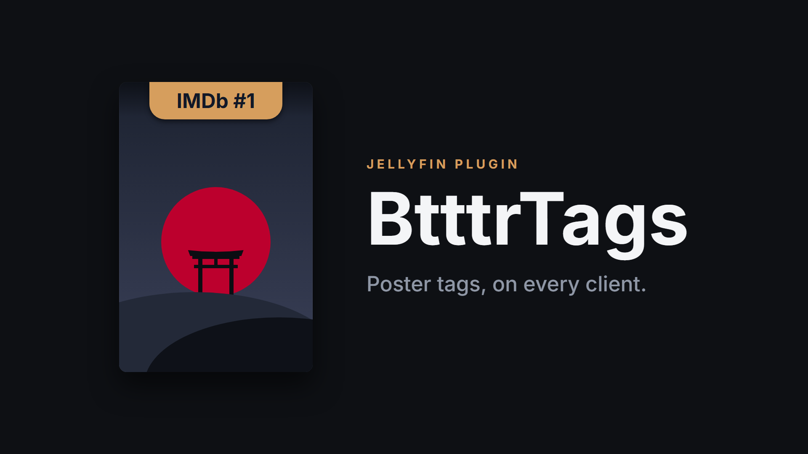

# BtttrTags for Jellyfin



BtttrTags is a Jellyfin server plugin that adds [btttr.cc](https://btttr.cc)-style hanging tags to the posters of your movies and series. The tags are drawn into the poster image on the server, so every client shows them without any client-side changes: web, Android TV, Apple TV, Fire TV, Roku, iOS and Android.

Your original posters are backed up before a tag is added, and restored automatically when a tag no longer applies.

## Features

- Tags for top-rated, trending, new and recently added titles, and for the status of TV series.
- Tag colors are taken from each poster's artwork. IMDb Top 250 titles get a gold tag.
- Original posters are backed up and restored without loss of quality. Every render starts from the clean original, so repeated updates never degrade the image.
- Posters you replace yourself are detected and kept. The plugin backs up your new poster and tags that instead.
- Runs automatically every day, and can be run on demand from the dashboard.
- Ranking lists are cached on disk, so a failed download never removes tags.

## Tags

Each title gets at most one tag. When several apply, the first one in this table wins.

| Tag | Applies to | When |
|---|---|---|
| `IMDb #N` | Movies and series | The title is in the IMDb Top 250. Movies and series are ranked separately. |
| `#N Today` or `Trending` | Movies and series | The title is in the current Cinemeta trending chart. The top 25 show their rank. |
| `New Movie` or `New Series` | Movies and series | Released within the last 90 days, or due out within the next 30. |
| `Just Added` | Movies and series | Added to your library within the last 30 days. |
| `Returning Series` | Series | The series is still airing. |
| `Binge Ready` | Series | The series has ended. |

Matching uses the IMDb ID in each item's metadata. Titles without an IMDb ID can still receive the New, Just Added and series status tags.

## Requirements

- Jellyfin Server 12.0 or later.
- Outbound internet access from the server, to download the IMDb Top 250 and trending lists.

## Installation

### From the plugin repository

1. In Jellyfin, open **Dashboard**, then **Plugins**, then **Repositories**.
2. Add a repository with this URL:
   ```
   https://raw.githubusercontent.com/MakD/jellyfin-btttrtags/main/manifest.json
   ```
3. Open the **Catalog**, select **BtttrTags** and install it.
4. Restart Jellyfin.

### Manual installation

1. Download `BtttrTags.zip` from the [latest release](https://github.com/MakD/jellyfin-btttrtags/releases/latest).
2. Extract `Jellyfin.Plugin.BtttrTags.dll` into a new folder named `BtttrTags_1.0.0.0` inside your Jellyfin `plugins` directory.
3. Restart Jellyfin.

## Usage

The **BtttrTags - Update Poster Overlays** scheduled task applies, updates and removes tags. It runs every day at 04:30, half an hour after Jellyfin's default library scan.

To tag your library straight away, open **Dashboard**, then **Scheduled Tasks**, and run the task. Clients show the updated posters once they refresh their image cache.

## Configuration

Open **Dashboard**, then **Plugins**, then **BtttrTags**.

| Setting | Default | Description |
|---|---|---|
| Enable Trending Tags | On | Shows `#N Today` or `Trending` for titles in the Cinemeta trending charts. |
| Enable IMDb Top 250 | On | Shows a gold `IMDb #N` tag for top-rated movies and shows. |
| Enable New Movie / New Series | On | Tags recent releases. |
| New Release Threshold (Days) | 90 | How long after release a title counts as new. |
| Enable Just Added | On | Tags titles recently added to your library. |
| Just Added Threshold (Days) | 30 | How long after being added a title counts as just added. |
| Enable TV Status Tags | On | Shows `Returning Series` or `Binge Ready` on series. |

Changes take effect on the next run of the scheduled task. Turning a tag type off restores the original posters of titles that no longer get a tag.

## Restoring original posters

Each original poster is stored under `BtttrTagsBackups` in Jellyfin's data directory before it is tagged. When a title no longer qualifies for a tag, its original is restored and the backup is removed.

To remove every tag at once, select **Restore All Original Clean Posters** on the plugin's configuration page. Only administrators can do this. If you uninstall the plugin, restore your posters first.

## Data sources

- IMDb Top 250 movies and shows: [MDBList](https://mdblist.com), refreshed weekly.
- Trending movies and series: [Cinemeta](https://cinemeta-catalogs.strem.io), refreshed every 12 hours.

The last good copy of each list is saved on disk. If a download fails or returns an incomplete list, the plugin keeps using the saved copy and tries again on the next run.

## Known limitations

- If a title's poster is stored in its media folder, a metadata refresh switches it back to that file and the tag disappears until the next scheduled run.
- Posters that are already tagged are not redrawn after an update to the plugin's tag design. They pick up the new design the next time their tag changes.
- Trending ranks for movies and series come from separate charts, so a movie and a series can share the same `#N Today` rank.

## Building from source

The project targets .NET 10 and references the Jellyfin server assemblies directly. Update the `HintPath` entries in `BtttrTagsPlugin.csproj` to point at your Jellyfin installation, then run:

```
dotnet build BtttrTagsPlugin.csproj -c Release
```

The plugin is written to `bin/Release/net10.0/Jellyfin.Plugin.BtttrTags.dll`.

## Credits

- Tag design inspired by [btttr.cc](https://btttr.cc).
- Tags are set in [Inter](https://rsms.me/inter/) by Rasmus Andersson, licensed under the SIL Open Font License 1.1.
